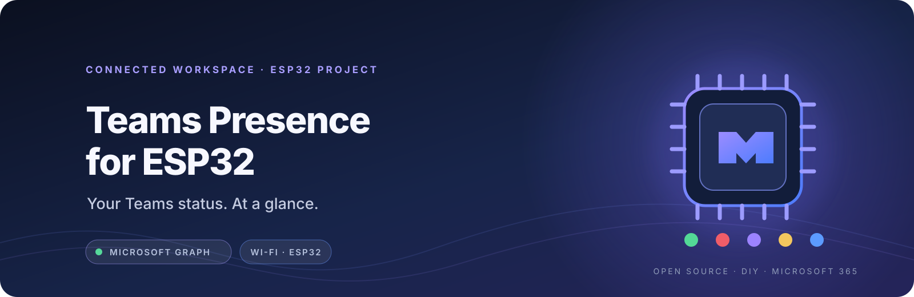
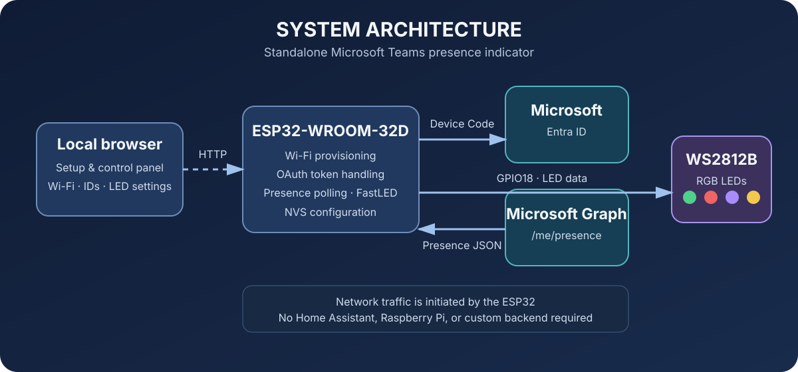
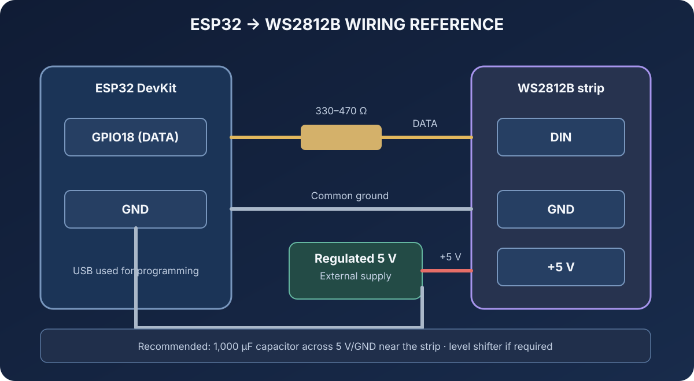
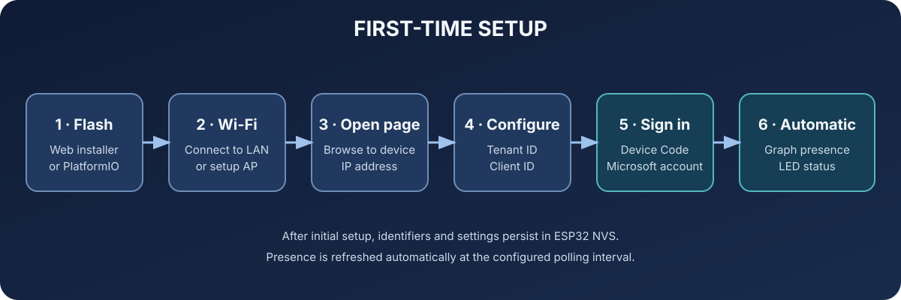

<!--
  TEAMS PRESENCE — visual identity
  Brand palette: midnight navy, Microsoft-inspired violet/blue, and LED status accents.
-->
<div align="center">



# Teams Presence for ESP32

**Your Teams status. At a glance.**

A standalone, Wi-Fi connected presence indicator powered by ESP32, Microsoft Graph and WS2812B LEDs.

<p>
  <a href="https://github.com/gianmarco112/esp32-teams-presence/releases"></a>
  <a href="https://github.com/gianmarco112/esp32-teams-presence/actions/workflows/firmware.yml"></a>
  <a href="https://github.com/gianmarco112/esp32-teams-presence/blob/main/LICENSE"></a>
</p>

<p>
  <a href="https://gianmarco112.github.io/esp32-teams-presence/"><strong>⚡ Web Installer</strong></a>
  &nbsp;·&nbsp;
  <a href="#features"><strong>Features</strong></a>
  &nbsp;·&nbsp;
  <a href="#hardware"><strong>Hardware</strong></a>
  &nbsp;·&nbsp;
  <a href="#first-time-setup"><strong>Get started</strong></a>
</p>

</div>

---


## Contents

- [Overview](#overview)
- [Features](#features)
- [Hardware](#hardware)
- [LED status mapping](#led-status-mapping)
- [First-time setup](#first-time-setup)
- [Microsoft Entra ID configuration](#microsoft-entra-id-configuration)
- [Build and upload locally](#build-and-upload-locally)
- [Web firmware installer](#web-firmware-installer)
- [Continuous integration and releases](#continuous-integration-and-releases)
- [Repository layout](#repository-layout)
- [Security and privacy](#security-and-privacy)
- [Troubleshooting](#troubleshooting)
- [License](#license)

## Overview

The ESP32 connects to Wi-Fi, authenticates directly with Microsoft Entra ID, and periodically queries Microsoft Graph for the presence of the signed-in user. The returned status is translated into a colour on the WS2812B LED strip.



<details>
<summary>How the data flows</summary>

1. The ESP32 connects to the configured Wi-Fi network.
2. The user completes Microsoft Device Code sign-in.
3. The firmware obtains and refreshes delegated OAuth tokens.
4. Microsoft Graph returns the signed-in user's presence.
5. FastLED updates the WS2812B strip to reflect the current status.

</details>

## Features

- **Standalone operation:** no Home Assistant instance, Raspberry Pi, or separate backend is required.
- **Wi-Fi provisioning:** WiFiManager provides a setup access point when the device needs network configuration.
- **Microsoft sign-in:** OAuth 2.0 Device Code Flow with a single-tenant Microsoft Entra application.
- **Presence retrieval:** reads the signed-in user's status through Microsoft Graph `GET /v1.0/me/presence`.
- **Automatic refresh:** stores the OAuth refresh token in ESP32 NVS and uses it to renew access tokens.
- **Addressable LEDs:** drives WS2812B LEDs through GPIO18 using FastLED.
- **Local control panel:** view connection and presence information, connect or disconnect Microsoft, and configure the device.
- **Persistent settings:** LED count, brightness, polling interval, and manual LED state are saved in NVS.
- **Build automation:** GitHub Actions builds the firmware and packages the binary files used by the web installer.

The local control panel currently supports a configurable LED count (1–300), brightness, and presence polling interval (10–3,600 seconds). The default polling interval is 60 seconds.

## Hardware

### Supported prototype

| Component | Configuration |
|---|---|
| Controller | ESP32 DevKit with ESP32-WROOM-32D module |
| Firmware target | PlatformIO `esp32dev` |
| LED type | WS2812B RGB addressable LEDs |
| LED data pin | GPIO18 |
| Default LED count | 8 |
| Flash layout | Custom 4 MB partition table |
| LED power | External regulated 5 V supply |

The custom partition table in `partitions.csv` requires an ESP32 board with **at least 4 MB of flash**. The ESP32-S3 is not the target for this firmware configuration.

### Wiring diagram



| ESP32 / power supply | WS2812B | Description |
|---|---|---|
| GPIO18 | DIN | LED data input |
| GND | GND | Common ground |
| External +5 V | +5 V | LED power |
| Power supply GND | GND | Common ground with the ESP32 |

**Important electrical notes**

- Do not power the LED strip from the ESP32 3.3 V pin.
- Use a regulated 5 V supply sized for the number of LEDs. For the 8-LED prototype, a 5 V / 1 A supply is a suitable starting point.
- The ESP32 data output is 3.3 V. A direct connection to a 5 V WS2812B strip may work, but is not guaranteed for every strip or revision. Use a 74AHCT125 or 74HCT14 level shifter if the LEDs flicker or show incorrect colours.
- A 330–470 Ω series resistor on the data line and a 1,000 µF capacitor across 5 V/GND near the strip are recommended.
- Connect GPIO18 to **DIN** on the first LED, following the data-direction arrow.
- Do not connect USB and an external 5 V source to the board simultaneously unless the board's power-path design is understood.

See [docs/wiring.md](docs/wiring.md) for the wiring reference.

## LED status mapping

| Microsoft presence | LED indication |
|---|---|
| Available | 🟢 Green |
| Busy | 🔴 Red |
| Do Not Disturb | 🟣 Purple |
| Away | 🟡 Yellow |
| Be Right Back | 🟠 Orange |
| Offline | ⚫ Off |
| Unknown / error | 🔵 Blue blinking |

A manual LED state can be selected from the local control panel. While manual mode is active, automatic presence changes do not override the selected LED state. Select **Automatic** to return to Teams-based indication.

## First-time setup



1. Flash the firmware using the [web installer](#web-firmware-installer) or PlatformIO.
2. Power on the ESP32.
3. If no saved Wi-Fi network is available, the device starts the **`TeamsPresence-Setup`** access point.
4. Connect a phone or computer to that Wi-Fi network and complete the WiFiManager network selection page.
5. Find the device's IP address in the PlatformIO serial monitor (115200 baud).
6. Open `http://<device-ip>/` from a device on the same local network.
7. In the local page, enter your organisation's **Directory (tenant) ID** and **Application (client) ID**, then select **Save Microsoft configuration**.
8. Select **Connect Microsoft**, open the Microsoft device sign-in page, and enter the displayed code.
9. After sign-in completes, the ESP32 begins polling Microsoft Graph and updates the LEDs.

The local page also provides controls for LED count, brightness, polling interval, manual LED state, Microsoft sign-out, and Wi-Fi reconfiguration.

## Microsoft Entra ID configuration

The firmware uses one **single-tenant public-client App Registration** for the organisation. End users sign in to that application; they do not need to create their own App Registration.

Create or configure the application in the Microsoft Entra admin center:

1. Open **App registrations** and create a new registration.
2. Choose **Accounts in this organizational directory only** (single tenant).
3. Under **Authentication → Advanced settings → Allow public client flows**, set **Enable the following mobile and desktop flows** to **Yes**, then save the change. This enables the **No keyboard (Device Code Flow)** authentication method required by the ESP32.
4. Under **API permissions**, add **Microsoft Graph → Delegated permissions → `Presence.Read`**.
5. Grant admin consent if required by the organisation's consent policy.

The application uses Device Code Flow and does **not** use a client secret. The firmware requests the `Presence.Read` and `offline_access` scopes.

### Configure the device

The firmware image is generic: it does not contain an organisation's Tenant ID or Client ID. After connecting the ESP32 to Wi-Fi, open its local web page and fill in:

| Field | Value |
|---|---|
| **Directory (tenant) ID** | Directory (tenant) ID from your App Registration |
| **Application (client) ID** | Application (client) ID from your App Registration |

Select **Save Microsoft configuration**, then select **Connect Microsoft** to complete Device Code Flow. The two identifiers are stored in ESP32 NVS and remain available after a reboot. They are public application identifiers, not client secrets; never configure or upload a client secret to the device.

Changing either identifier invalidates the stored refresh token and requires the Microsoft account to sign in again. No GitHub Actions variables are required to build or publish the generic firmware.

### Presence scope

The firmware calls `/me/presence`. It therefore reads the presence of **the Microsoft account that signed in on that particular ESP32**. It does not let one user choose or monitor another user's presence.

## Build and upload locally

### Requirements

- Visual Studio Code with the PlatformIO IDE extension, or PlatformIO Core.
- Git.
- USB data cable and the appropriate USB-to-serial driver for the ESP32 DevKit.

### Clone and configure

```bash
git clone https://github.com/gianmarco112/esp32-teams-presence.git
cd esp32-teams-presence
```

Copy the example configuration:

**Windows PowerShell**
```powershell
Copy-Item include/config.h.example include/config.h
```

**Linux / macOS**
```bash
cp include/config.h.example include/config.h
```

Edit `include/config.h` only when you need to change hardware or firmware defaults. Tenant ID and Client ID are entered later from the ESP32 web page:

```cpp
#define LED_PIN 18
#define LED_COUNT 8
#define LED_BRIGHTNESS 80
#define PRESENCE_POLL_MS 60000UL
#define WEB_PORT 80
```

Build and upload:

```bash
pio run -e esp32dev
pio run -e esp32dev -t upload
pio device monitor -b 115200
```

The local configuration file `include/config.h` is excluded from Git. Keep it local and do not commit it.

## Web firmware installer

The browser-based installer is published through GitHub Pages:

**[Open Teams Presence Firmware Installer](https://gianmarco112.github.io/esp32-teams-presence/)**

It provides:

- installation of the latest stable GitHub Release;
- selection of earlier stable versions for reinstall or downgrade;
- USB serial connection and flash progress reporting.

### Browser and connection requirements

- Use an up-to-date **Google Chrome** or **Microsoft Edge** on desktop.
- The installer must be opened over HTTPS.
- Connect the ESP32 with a USB data cable and select its serial port when prompted.
- Web Serial is not supported by Safari or iOS browsers.

The installer only enables a release when the expected manifest and firmware assets are available. A successful browser flash does not replace testing the firmware on the actual board.

## Continuous integration and releases

The repository uses two GitHub Actions workflows:

| Workflow | Purpose |
|---|---|
| `firmware.yml` | Builds the generic ESP32 firmware on pushes to `main`, pull requests, and manual runs. On version tags, it packages the firmware, publishes a GitHub Release, and deploys the installer with the release assets. |
| `pages.yml` | Publishes installer changes to GitHub Pages and supports manual deployment. |

### Publish a test build

To publish a pre-release for testing, create and push a tag containing a hyphen:

```bash
git tag v0.1.0-rc.1
git push origin v0.1.0-rc.1
```

Tags containing a hyphen are published as GitHub pre-releases. They appear in the installer's **Advanced → Test versions** section and are not offered as the default stable installation.

### Publish a stable build

After the test firmware has been validated on the target hardware, create a stable tag:

```bash
git tag v1.0.0
git push origin v1.0.0
```

The firmware workflow then:

1. builds the generic `esp32dev` target with PlatformIO;
2. packages `bootloader.bin`, `partitions.bin`, `boot_app0.bin`, and `firmware.bin`;
3. generates `manifest.json` and `SHA256SUMS`;
4. publishes a GitHub Release (pre-release for tags containing a hyphen);
5. stages release assets under the installer site and deploys GitHub Pages.

The generic firmware contains no organisation-specific Tenant ID or Client ID. Each ESP32 receives those values through its local configuration page.

A successful CI build confirms compilation and packaging, not physical operation. Keep test builds marked as pre-releases until the firmware has been flashed and validated on the actual ESP32 hardware.

## Repository layout

```text
.
├── .github/
│   └── workflows/
│       ├── firmware.yml       # Firmware build and release pipeline
│       └── pages.yml          # Installer and release-asset deployment
├── docs/
│   ├── images/
│   │   ├── architecture.svg  # System architecture diagram
│   │   ├── setup-flow.svg     # Provisioning and sign-in flow
│   │   └── wiring.svg         # ESP32 and WS2812B wiring diagram
│   └── wiring.md              # ESP32 and WS2812B wiring reference
├── include/
│   └── config.h.example       # Local firmware configuration template
├── installer/
│   ├── index.html             # Web installer interface
│   ├── installer.js           # Web Serial flashing logic
│   ├── style.css
│   └── README.md
├── scripts/
│   └── package_firmware.py    # Packages binaries and manifest
├── src/
│   └── main.cpp               # ESP32 firmware
├── partitions.csv             # Custom 4 MB partition table
└── platformio.ini              # PlatformIO environment and dependencies
```

## Security and privacy

- **No backend service:** authentication and Microsoft Graph requests run directly from the ESP32.
- **Delegated access:** the device requests the signed-in user's presence through Microsoft Graph `/me/presence`.
- **TLS verification:** HTTPS requests use the ESP32 certificate bundle. Certificate verification must remain enabled.
- **Configuration storage:** Tenant ID and Client ID are stored in ESP32 NVS. They are public application identifiers, not credentials or client secrets.
- **Token storage:** the refresh token is stored in ESP32 NVS. Standard NVS storage is not automatically encrypted.
- **Local web interface:** the device control page uses HTTP on the local network and currently has no application-level password. Keep the device on a trusted network and do not expose its web interface directly to the Internet.
- **Physical access:** anyone with physical access or suitable access to the device's flash may be able to recover locally stored data unless additional ESP32 security features are configured.

Secure Boot, Flash Encryption, OTA firmware updates, and production hardening are not currently implemented as part of this project. Review the threat model and apply appropriate device-level protections before deploying devices in sensitive environments.

## Troubleshooting

| Symptom | Checks |
|---|---|
| The setup Wi-Fi is not visible | Restart the ESP32 and check the serial output at 115200 baud. Confirm that the board has power. |
| The local page does not open | Confirm that the computer is on the same network and use the IP address printed to Serial. |
| Microsoft sign-in fails | Check the Tenant ID and Client ID saved on the ESP32, public-client flow setting, delegated `Presence.Read` permission, and tenant consent policy. |
| LEDs flicker or show random colours | Check the 5 V supply and common ground. Try a data-line resistor and a 5 V-compatible level shifter. |
| The web installer cannot see the ESP32 | Use Chrome or Edge on desktop, a USB data cable, the correct USB serial driver, and a direct USB connection. |
| Firmware release is not listed | Confirm that the GitHub Release is published (not a draft or prerelease) and contains `manifest.json` plus all firmware binaries. |

## License

No `LICENSE` file is currently included in this repository. Until a license is added, reuse and redistribution permissions have not been explicitly granted. Add a license before presenting the project as an openly licensed distribution.
